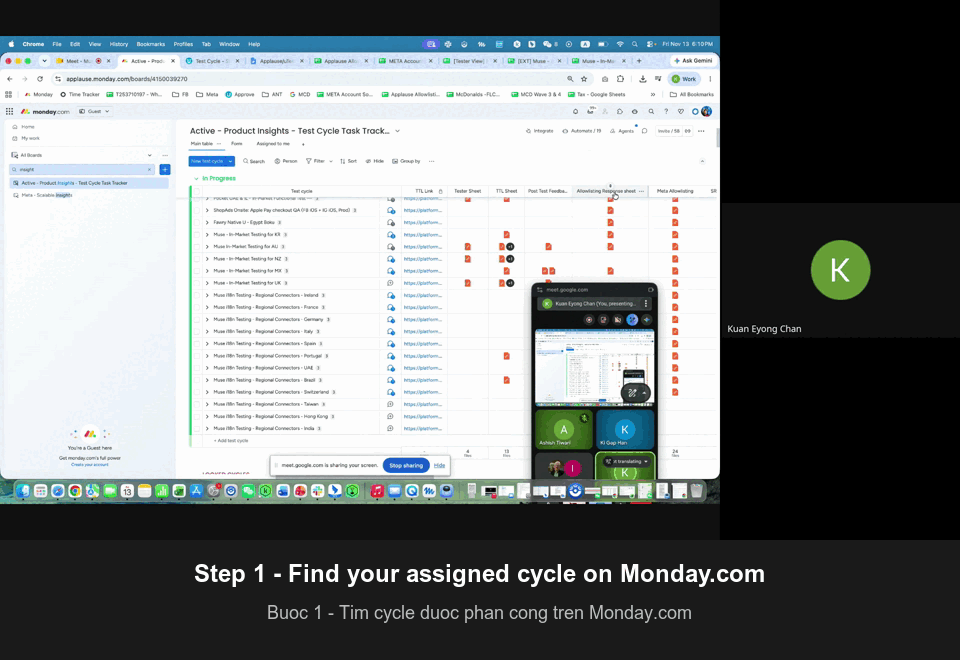

# Muse (Meta) — TTL triage workflow

*Quy trình triage của TTL cho dự án Muse (Meta) — tiếng Anh là chính, tiếng Việt bên dưới mỗi mục.*

This is a visual walkthrough of what a TTL (Test Team Lead) actually does on
the Muse project, end to end — from finding your assigned cycle to flagging
tester bonuses. It was reconstructed from a recorded TTL onboarding call
(screen share + narration), not from live production access, so treat the
exact sheet names/columns as a starting map to confirm against the real
documents, not a guaranteed schema.

*Đây là hướng dẫn trực quan toàn bộ công việc của một TTL trên dự án Muse —
từ lúc tìm cycle được phân công cho đến lúc đánh dấu bonus cho tester. Nội
dung được dựng lại từ một buổi ghi hình onboarding TTL (chia sẻ màn hình +
lời thuyết trình), không phải từ quyền truy cập thực tế, nên hãy coi tên
sheet/cột dưới đây là bản đồ ban đầu cần đối chiếu lại với tài liệu thật.*

## The 6 steps

### Step 1 — Find your assigned cycle on Monday.com
Every Muse test cycle (one per country/locale) is tracked as a row on a
Monday.com board. Find your name in the TTL column to see which cycle(s)
you're responsible for, then use that row's links to jump straight to the
cycle's TTL Sheet, Tester Sheet, and Allowlisting Response sheet — these are
the links the rest of this workflow depends on.

*Mỗi test cycle của Muse (theo từng quốc gia/ngôn ngữ) được theo dõi bằng
một dòng trên bảng Monday.com. Tìm tên bạn trong cột TTL để biết mình phụ
trách cycle nào, rồi dùng các liên kết trên dòng đó để mở nhanh TTL Sheet,
Tester Sheet, và Allowlisting Response sheet của cycle — đây là các liên kết
mà toàn bộ quy trình bên dưới phụ thuộc vào.*

### Step 2 — Verify tester allowlisting status
Before a cycle activates, testers claim a slot and submit a form with the
account details (TestFlight email, Google Play email, Facebook/Meta email)
needed to be allowlisted by the client. Cross-check each submission against
the evidence/screenshot the tester provided, then move confirmed entries
forward: first into the Meta Allowlisting Sheet (for client review), then —
once the client confirms — into the Applause Allowlisting Sheet, which is
what the client reads to know who's officially onboarded.

*Trước khi cycle kích hoạt, tester nhận slot và nộp form cung cấp thông tin
tài khoản (email TestFlight, email Google Play, email Facebook/Meta) để
được client allowlist. Đối chiếu từng submission với bằng chứng/ảnh chụp
màn hình tester cung cấp, sau đó chuyển các mục đã xác nhận: trước tiên vào
Meta Allowlisting Sheet (để client review), rồi khi client xác nhận, chuyển
tiếp vào Applause Allowlisting Sheet — đây là sheet mà client đọc để biết ai
đã được onboard chính thức.*

### Step 3 — Open the cycle's Test Cases tab on uTest
Once testers are allowlisted, they claim test-case slots directly on uTest
and start submitting. uTest's own Test Cases tab is where you see the
high-level claim/submission status (New, Started, Passed, Failed) per
tester — this is your queue of what's ready to triage.

*Sau khi tester được allowlist, họ claim slot test case trực tiếp trên
uTest và bắt đầu nộp bài. Tab Test Cases của uTest là nơi bạn thấy trạng
thái claim/submit tổng quan (New, Started, Passed, Failed) theo từng
tester — đây chính là hàng đợi cần triage.*

### Step 4 — Compare each tester's video vs Expected Result
Because a single connector (Stripe Link, Shop Pay, Shopping Catalog, …) can
need far more granular steps than uTest's own test-case UI comfortably
holds, the real step-by-step evidence — a short video per step, plus notes
— lives in a companion "Tester View" Google Sheet instead. Open it, find
the tester's row, and watch each video against that step's own Expected
Result column before deciding Pass or Fail.

*Vì một connector (Stripe Link, Shop Pay, Shopping Catalog, …) có thể cần
nhiều bước chi tiết hơn mức mà giao diện test case của uTest hiển thị thoải
mái, nên bằng chứng từng bước thực tế — một video ngắn mỗi bước, kèm ghi
chú — được lưu trong một Google Sheet "Tester View" riêng. Mở sheet đó, tìm
dòng của tester, và xem từng video đối chiếu với cột Expected Result của
bước đó trước khi quyết định Pass hay Fail.*

### Step 5 — Copy verified Pass results + video link to the client sheet
Once a tester's video genuinely matches the Expected Result, copy that
result and their notes from the Tester View sheet into the client-facing
"External" sheet (same rows, organized by connector) — and paste in the
verified, working share link for that video. This External sheet, not the
Tester View sheet, is what the client actually reads.

*Khi video của tester thực sự khớp với Expected Result, copy kết quả và ghi
chú đó từ Tester View sheet sang sheet "External" dành cho client (cùng cấu
trúc dòng, chia theo connector) — và dán vào đó link chia sẻ video đã xác
minh là hoạt động. Sheet External này, chứ không phải Tester View, mới là
cái client thực sự đọc.*

### Step 6 — Update the Tracking Sheet and flag bonus eligibility
Record the final status, device/environment, and bug ID (if any) in the
Tracking Sheet. Then check the gap between the tester's submission time and
when you completed the triage: if it's a valid result completed within 6
hours, flag them for the $10 bonus. If the tester was blocked by something
outside their control, the 6-hour clock restarts from when the blocker was
resolved, not from their original submission.

*Ghi lại trạng thái cuối cùng, thiết bị/môi trường, và bug ID (nếu có) vào
Tracking Sheet. Sau đó kiểm tra khoảng cách giữa thời điểm tester nộp bài và
lúc bạn hoàn tất triage: nếu là kết quả hợp lệ và hoàn thành trong vòng 6
giờ, đánh dấu họ nhận bonus $10. Nếu tester bị chặn bởi lý do ngoài tầm
kiểm soát của họ, mốc 6 giờ được tính lại từ lúc blocker được xử lý xong,
không phải từ lúc họ nộp bài ban đầu.*

---

*Source: recorded TTL onboarding walkthrough for the Muse project.*
*Nguồn: buổi ghi hình onboarding TTL của dự án Muse.*
